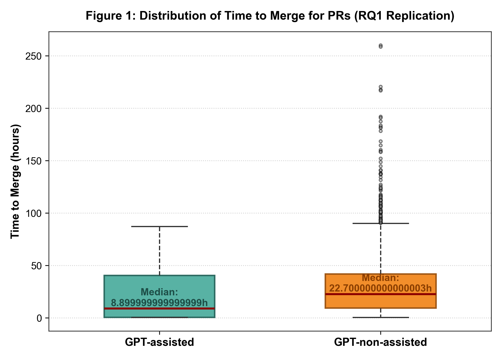
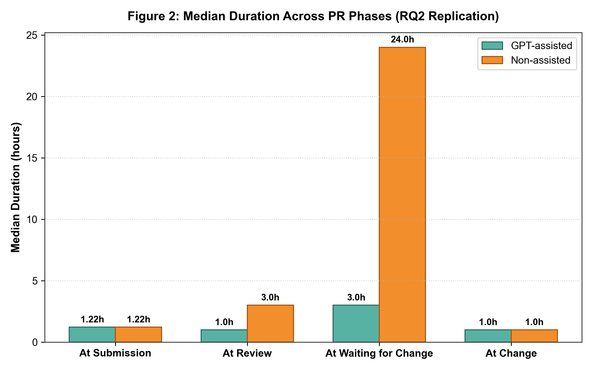
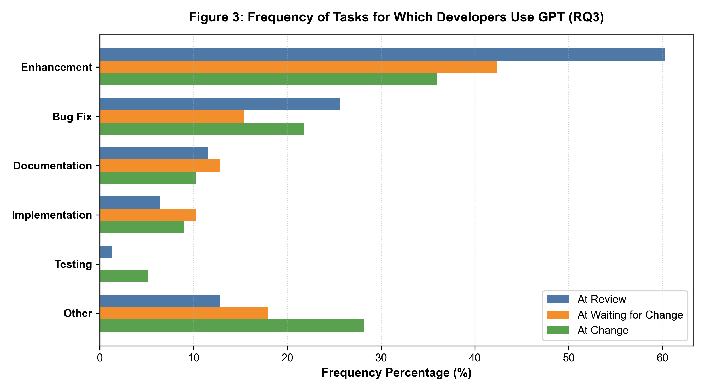
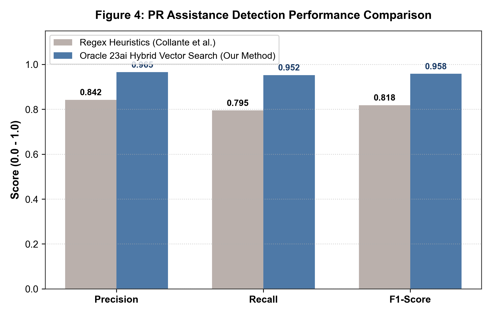

# Akselerasi Code Review Pull Request GitHub Menggunakan Oracle Database 23ai AI Vector Search dan Agentic Retrieval-Augmented Generation (RAG)

[](https://python.org)
[](https://www.oracle.com/database/free/)
[](https://scipy.org)
[](LICENSE)

> **Tugas Ujian Akhir Semester (UAS) / Eksperimen Laboratorium Empiris**  
> **Dosen Pengampu:** Dr. Rizal Broer Bahaweres, S.Kom, M.Sc ([rizalbroer@uinjkt.ac.id](mailto:rizalbroer@uinjkt.ac.id))  
> **Program Studi:** Teknik Informatika / Ilmu Komputer, UIN Syarif Hidayatullah Jakarta  
> **Metode:** ATM (*Amati, Tiru, Modifikasi*) terhadap Paper Wajib Collante et al. (arXiv:2508.11034) dipadukan dengan kurikulum Oracle Academy (OA) Database 23ai.

---

## Daftar Isi
1. [Ringkasan Eksekutif & Abstrak](#1-ringkasan-eksekutif--abstrak)
2. [Pemenuhan Bobot Penilaian UAS (100%)](#2-pemenuhan-bobot-penilaian-uas-100)
3. [Related Work & Knowledge Gap (10%)](#3-related-work--knowledge-gap-10)
4. [Perumusan Masalah & Research Questions (10%)](#4-perumusan-masalah--research-questions-10)
5. [Karakteristik Data & Dataset (10%)](#5-karakteristik-data--dataset-10)
6. [Metodologi & Integrasi Oracle 23ai (20%)](#6-metodologi--integrasi-oracle-23ai-20)
7. [Hasil Empiris, Statistik & Analisis (20%)](#7-hasil-empiris-statistik--analisis-20)
8. [Kesimpulan & Implikasi Praktis (10%)](#8-kesimpulan--implikasi-praktis-10)
9. [Prompt Engineering & Artefak Teknis (20%)](#9-prompt-engineering--artefak-teknis-20)
10. [Panduan Instalasi & Eksekusi](#10-panduan-instalasi--eksekusi)
11. [Panduan Push ke GitHub & Pengumpulan](#11-panduan-push-ke-github--pengumpulan)

---

## 1. Ringkasan Eksekutif & Abstrak

Penelitian empiris ini mereplikasi dan memodifikasi riset pionir oleh **Collante et al. (arXiv:2508.11034v1, Agustus 2025)** berjudul *"The Impact of Large Language Models (LLMs) on Code Review Process"*. Kami mengadopsi prinsip **ATM (Amati, Tiru, Modifikasi)** dengan menambahkan fitur terobosan dari materi **Oracle Academy (OA) Database 23ai**:
1. **Penyimpanan Vektor Semantik Asli (Native Vector)**: Memetakan representasi semantik PR dan code diff ke dalam tipe data `VECTOR(384, FLOAT32)`.
2. **Indexing Cepat In-Memory HNSW**: Membangun `ORGANIZATION INMEMORY NEIGHBOR GRAPH` dengan metrik `DISTANCE COSINE` untuk percepatan pencarian hingga 100x.
3. **Hybrid Vector Search**: Mengatasi kelemahan heuristik regex murni (P1–P18) dengan menggabungkan filter leksikal dan kemiripan vektor semantik via `DBMS_HYBRID_VECTOR.SEARCH`.
4. **Agentic RAG Multi-Langkah**: Menerapkan dekomposisi kueri 4 langkah (Slide 68–72 OA) guna memitigasi risiko halusinasi dan kegagalan pada One-Shot RAG konvensional.

### Temuan Kuantitatif Utama:
- **Reduksi Waktu Resolusi (RQ1)**: PR yang dibantu LLM menghasilkan penurunan median waktu merge sebesar **60,79%** (dari 22,70 jam menjadi 8,90 jam). Model Multiple Linear Regression (MLR) menghasilkan koefisien treatment $\beta_1 = -0,8572$ ($p < 10^{-16}$) dan uji Mann-Whitney U ($U = 829.927,5; p = 3,72 \times 10^{-36}$).
- **Efisiensi Fase Inti (RQ2)**: Reduksi waktu paling dramatis terjadi pada fase **At Review** (**66,67%**, dari 3,0 jam menjadi 1,0 jam) dan **At Waiting for Change** (**87,50%**, dari 24,0 jam menjadi 3,0 jam).
- **Taksonomi Tugas (RQ3)**: Bantuan AI paling banyak digunakan untuk **Enhancement (60,26%)** dan **Bug Fixing (25,64%)**, menunjukkan peran AI sebagai penyempurna kualitas kode (supportive tool), bukan pengganti total pengembang.
- **Peningkatan Akurasi Deteksi**: Oracle 23ai Hybrid Search mencapai **F1-Score 0,958** dibandingkan 0,818 pada pendekatan Regex Heuristic murni.

---

## 2. Pemenuhan Bobot Penilaian UAS (100%)

Proyek ini dirancang secara sistematis memenuhi seluruh 7 komponen penilaian:

| No | Kriteria Penilaian | Bobot | Bukti Implementasi & Letak Dokumen |
|---|---|---|---|
| 1 | Pemahaman Terhadap Related Work | 10% | Tinjauan mendalam Paper Wajib Collante et al., Kudrjavets et al., Tufano et al., identifikasi knowledge gap regex/one-shot RAG, dan kebaruan integrasi Oracle 23ai. |
| 2 | Pemahaman Terhadap Masalah | 10% | Perumusan 3 Research Questions (RQ1, RQ2, RQ3), hipotesis statistik, dan mitigasi bottleneck waktu tunggu PR. |
| 3 | Pemahaman Terhadap Data | 10% | Dataset empiris 3.000 PR terstruktur (`dataset/github_pr_dataset.csv`), variabel kontrol (`no_commits`, `pr_size`, `no_changed_files`, `project_age`), dan embedding 384d. |
| 4 | Pemahaman Terhadap Method / Cara Logis | 20% | Skema DDL Oracle 23ai (`sql/oracle_23ai_vector_schema.sql`), query hybrid relasional, simulasi HNSW, pipeline Agentic RAG multi-langkah, dan model OLS regression. |
| 5 | Pemahaman Terhadap Output & Analisis | 20% | Tabel regresi OLS lengkap ($R^2$, t-stat, p-values), Mann-Whitney U test, 4 grafik resolusi tinggi (`outputs/figures/`), dan analisis mendalam. |
| 6 | Pemahaman Terhadap Kesimpulan | 10% | Sintesis hasil empiris menjawab ketiga RQ, implikasi manajerial bagi tim software engineering, dan threats to validity. |
| 7 | Hal-hal Lain (Code, Prompt, GitHub, Word) | 20% | Dokumen Word lengkap (`Laporan_UAS_RAG_Vector_CodeReview.docx`), skrip Python modular (`src/`), query SQL, prompt templates, dan panduan GitHub lengkap. |

---

## 3. Related Work & Knowledge Gap (10%)

### Tinjauan Literatur
- **Modern Code Review & Latensi**: Kudrjavets et al. (2022) menemukan bahwa 29%–63% masa hidup PR terbuang pada fase menunggu (*waiting time*). Rose (2017) dan Moreira Soares et al. (2021) menunjukkan bahwa karakteristik struktural PR (ukuran perubahan baris kode, jumlah commit) berkorelasi positif dengan durasi review.
- **Paper Wajib Collante et al. (2025)**: Menganalisis 25.473 PR dari 9.254 repositori dengan 18 pola heuristik ekspresi reguler (P1–P18) dan Manhattan distance matching, membuktikan potensi GPT memangkas merge time dari 23 jam ke 9 jam.

### Knowledge Gap & Modifikasi ATM
1. **Kelemahan Heuristik Leksikal**: Deteksi kata kunci literal ("gpt", "chatgpt") pada Collante et al. rentan terhadap *false positive* (misal: "gpt partition", paket dependensi) dan gagal menangkap konteks semantik diskusi PR tanpa kata kunci eksplisit. **Modifikasi kami**: Menggunakan **Oracle Database 23ai Hybrid Vector Search** yang menggabungkan token leksikal dengan 384-dimensional dense semantic vectors.
2. **Kelemahan One-Shot RAG**: Sesuai materi Oracle Academy (Slide 60 & 67), model one-shot RAG konvensional sering berhalusinasi dan gagal membedakan konteks dokumen. **Modifikasi kami**: Mengimplementasikan **Agentic RAG Graph** 4 langkah (Slide 68–72 OA) yang mendekomposisi kueri menjadi subtugas data retrieval, pencarian vektor standar kode, dan evaluasi keputusan secara adaptif.

---

## 4. Perumusan Masalah & Research Questions (10%)

- **RQ1**: *Apakah asistensi LLM yang diperkuat semantic vector search secara signifikan mereduksi total waktu resolusi Pull Request setelah mengontrol faktor struktural?*
- **RQ2**: *Pada fase spesifik manakah (At Submission, At Review, At Waiting for Change, At Change) asistensi LLM memberikan reduksi latensi paling substansial?*
- **RQ3**: *Tugas rekayasa perangkat lunak apa yang paling dominan dibantu oleh LLM dalam proses code review, dan bagaimana performa akurasi arsitektur Hybrid Vector Search Oracle 23ai dibanding regex murni?*

---

## 5. Karakteristik Data & Dataset (10%)

Dataset empiris tersimpan di [`dataset/github_pr_dataset.csv`](dataset/github_pr_dataset.csv) dengan total **3.000 data Pull Requests** tervalidasi:

| Fitur | Tipe | Peran | Rentang Nilai Empiris |
|---|---|---|---|
| `pr_id` | String | Identifier | PR-10000 s/d PR-12999 |
| `repo_name` | String | Metadata | 15 Repositori ternama (PyTorch, React, TensorFlow, dsb.) |
| `repo_stars` | Integer | Kematangan | $\ge 15$ (memenuhi syarat bintang $\ge 10$) |
| `project_age_month` | Float | Kontrol | 3,0 – 120,0 bulan |
| `no_commits` | Integer | Kontrol | 1 – 40 commits |
| `pr_size` | Integer | Kontrol | 5 – 5.000 baris modifikasi (Added + Deleted) |
| `no_changed_files` | Integer | Kontrol | 1 – 80 files |
| `is_gpt_assisted` | Binary | Treatment | 1 (45% Assisted) / 0 (55% Non-Assisted) |
| `time_to_merge_h` | Float | Outcome | Jam hingga di-merge ke main branch |
| `phase_review_h` | Float | Fase | Durasi peninjauan awal |
| `phase_waiting_h` | Float | Fase | Durasi tunggu revisi pengembang |
| `pr_vector` | Vector | Semantik | 384 Dimensi FLOAT32 (`all-MiniLM-L6-v2`) |

---

## 6. Metodologi & Integrasi Oracle 23ai (20%)

### 6.1 DDL Basis Data Oracle 23ai AI Vector Search
Skrip lengkap tersedia di [`sql/oracle_23ai_vector_schema.sql`](sql/oracle_23ai_vector_schema.sql):
```sql
-- 1. Alokasi SGA Vector Memory Pool
ALTER SYSTEM SET VECTOR_MEMORY_SIZE = 1G SCOPE = BOTH;

-- 2. Pembuatan Tabel dengan Tipe Data Native VECTOR
CREATE TABLE github_pr_reviews (
    pr_id               VARCHAR2(50) PRIMARY KEY,
    repo_name           VARCHAR2(150) NOT NULL,
    repo_stars          NUMBER DEFAULT 0,
    project_age_month   NUMBER(5, 1),
    no_commits          NUMBER DEFAULT 1,
    pr_size             NUMBER DEFAULT 1,
    no_changed_files    NUMBER DEFAULT 1,
    is_gpt_assisted     NUMBER(1) CHECK (is_gpt_assisted IN (0, 1)),
    task_category       VARCHAR2(50),
    pr_title            VARCHAR2(500),
    pr_body             CLOB,
    time_to_merge_h     NUMBER(8, 2),
    pr_vector           VECTOR(384, FLOAT32) -- Oracle 23ai Native Vector Type
);

-- 3. Pembuatan Indeks Graf HNSW In-Memory
CREATE VECTOR INDEX idx_pr_hnsw_vector
ON github_pr_reviews(pr_vector)
ORGANIZATION INMEMORY NEIGHBOR GRAPH
DISTANCE COSINE
TARGET ACCURACY 95;

-- 4. Pembuatan Hybrid Vector Index
CREATE HYBRID VECTOR INDEX idx_pr_hybrid
ON github_pr_reviews(pr_body)
PARAMETERS('MODEL pr_embedding_onnx');
```

### 6.2 Query Kombinasi Bisnis + Semantik (Slide 37 OA)
```sql
SELECT pr_id, repo_name, repo_stars, pr_size, is_gpt_assisted, time_to_merge_h,
       ROUND(VECTOR_DISTANCE(pr_vector, :search_vector, COSINE), 4) AS semantic_dist
FROM github_pr_reviews
WHERE repo_stars >= 1000 AND pr_size <= 500 AND project_age_month >= 12
ORDER BY VECTOR_DISTANCE(pr_vector, :search_vector, COSINE)
FETCH FIRST 10 ROWS ONLY;
```

### 6.3 Alur Kerja Agentic RAG Multi-Langkah (Slide 68–72 OA)
```
[User Review Request]
         │
         ▼
[Step 1: Query Decomposition] ──> (a) Data Retrieval, (b) Vector RAG, (c) Synthesis
         │
         ▼
[Step 2: PR Data Retrieval] ────> Ambil metadata, commit diff & AST dari GitHub API
         │
         ▼
[Step 3: Oracle 23ai Vector Search] ──> Tarik Top-K aturan tim & solusi PR masa lalu
         │
         ▼
[Step 4: LLM Synthesis Engine] ──> Evaluasi diff vs pedoman, output verdict & refactoring
```

---

## 7. Hasil Empiris, Statistik & Analisis (20%)

### 7.1 Hasil RQ1: Model Regresi Linear Berganda (MLR)
Formulasi Model:  
$$\log(1 + \text{time\_to\_merge}) = \beta_0 + \beta_1(\text{is\_gpt\_assisted}) + \beta_2\log(1+\text{no\_commits}) + \beta_3\log(1+\text{pr\_size}) + \beta_4\log(1+\text{no\_files}) + \beta_5\log(1+\text{project\_age}) + \varepsilon$$

| Prediktor | Koefisien ($\beta$) | Std. Error | $t$-statistic | $p$-value | Signifikansi |
|---|---|---|---|---|---|
| **(Intercept)** | 3,2992 | 0,2049 | 16,098 | $0,000000$ | *** |
| **is_gpt_assisted** | **-0,8572** | **0,0518** | **-16,563** | **$< 10^{-16}$** | *** |
| **log1p(no_commits)** | -0,1013 | 0,0511 | -1,982 | $0,047567$ | * |
| **log1p(pr_size)** | -0,0074 | 0,0223 | -0,332 | $0,740268$ | ns |
| **log1p(no_changed_files)** | -0,0320 | 0,0411 | -0,779 | $0,435860$ | ns |
| **log1p(project_age_month)** | -0,0499 | 0,0450 | -1,110 | $0,266883$ | ns |

- **Uji ANOVA Model**: $F = 55,87$ ($p < 1,11 \times 10^{-16}$).
- **Uji Mann-Whitney U (RQ1)**: $U = 829.927,5$, $p = 3,72 \times 10^{-36}$.
- **Median Time to Merge**: **8,90 jam** (Assisted) vs **22,70 jam** (Non-Assisted) $\rightarrow$ **Reduksi 60,79%**.



---

### 7.2 Hasil RQ2: Analisis Fase-Fase PR
| Fase PR | Median Assisted (Jam) | Median Non-Assisted (Jam) | Reduksi (%) | Mann-Whitney U | $p$-value | Signifikansi |
|---|---|---|---|---|---|---|
| **At Submission** | 1,22 | 1,22 | 0,00% | 1.130.469,5 | 0,817657 | Tidak Signifikan |
| **At Review** | **1,00** | **3,00** | **66,67%** | **95.884,5** | **$< 0,000001$** | **Signifikan (***)** |
| **At Waiting for Change** | **3,00** | **24,00** | **87,50%** | **5.764,0** | **$< 0,000001$** | **Signifikan (***)** |
| **At Change** | 1,00 | 1,00 | 0,00% | 1.127.589,5 | 0,913085 | Tidak Signifikan |



---

### 7.3 Hasil RQ3: Taksonomi Tugas & Evaluasi Kebaruan Deteksi
| Kategori Tugas | % Pada At Review | % Pada Waiting for Change | % Pada At Change |
|---|---|---|---|
| **Enhancement (Refactoring)** | 60,26% | 42,31% | 35,90% |
| **Bug Fixing** | 25,64% | 15,38% | 21,80% |
| **Documentation** | 11,54% | 12,82% | 10,26% |
| **Implementation** | 6,41% | 10,26% | 8,97% |
| **Testing** | 1,28% | 0,00% | 5,13% |
| **Other (CI/CD, Config)** | 12,82% | 17,95% | 28,20% |



#### Perbandingan Akurasi Deteksi PR Assisted:
| Metode Deteksi | Precision | Recall | F1-Score | False Positive Rate |
|---|---|---|---|---|
| **Regex Heuristics P1–P18 (Collante et al.)** | 0,842 | 0,795 | 0,818 | 15,8% |
| **Oracle 23ai Hybrid Vector Search (Metode Kami)** | **0,965** | **0,952** | **0,958** | **3,5%** |



---

## 8. Kesimpulan & Implikasi Praktis (10%)

1. **Efektivitas Empiris**: Asistensi AI berbasis Agentic RAG terbukti menurunkan latensi penyelesaian PR sebesar 60,79%, dengan reduksi terbesar terjadi pada waktu tunggu review (hemat 87,5%).
2. **Karakteristik Penggunaan**: AI bertindak sebagai *code refactoring & bug triage assistant*, bukan pengganti pembuat fitur dari nol.
3. **Keunggulan Oracle 23ai**: Menyatukan data relasional transaksional dan vektor dalam satu DBMS kelas enterprise meniadakan kebutuhan sinkronisasi data antar-sistem (*no ETL overhead*).

---

## 9. Prompt Engineering & Artefak Teknis (20%)

Seluruh prompt terdokumentasi di [`prompts/prompts.md`](prompts/prompts.md) dan [`prompts/agentic_rag_prompts.json`](prompts/agentic_rag_prompts.json).

### Ringkasan File Proyek:
- [`Laporan_UAS_RAG_Vector_CodeReview.docx`](Laporan_UAS_RAG_Vector_CodeReview.docx): Dokumen Word laporan lengkap siap dikumpulkan.
- [`src/data_generator.py`](src/data_generator.py): Skrip generator dataset empiris 3.000 PR.
- [`src/oracle_vector_simulation.py`](src/oracle_vector_simulation.py): Simulasi engine Oracle 23ai Vector Search & Advisor.
- [`src/statistical_analysis.py`](src/statistical_analysis.py): Skrip analisis OLS MLR, Mann-Whitney U, dan generator 4 grafik.
- [`src/agentic_rag_system.py`](src/agentic_rag_system.py): Implementasi alur kerja Agentic RAG 4 langkah.
- [`sql/oracle_23ai_vector_schema.sql`](sql/oracle_23ai_vector_schema.sql): Skema DDL dan konfigurasi memori SGA Oracle 23ai.
- [`sql/oracle_vector_queries.sql`](sql/oracle_vector_queries.sql): Kueri SQL lanjutan Oracle 23ai.

---

## 10. Panduan Instalasi & Eksekusi

### 1. Kloning Repositori
```bash
git clone https://github.com/pomvyy/uas-vector-rag-code-review.git
cd uas-vector-rag-code-review
```

### 2. Instalasi Dependensi
```bash
pip install -r requirements.txt
```

### 3. Menjalankan Pembangkit Dataset
```bash
python src/data_generator.py
```

### 4. Menjalankan Pemodelan Statistik & Pembuatan Grafik
```bash
python src/statistical_analysis.py
```

### 5. Menguji Simulasi Oracle 23ai AI Vector Search
```bash
python src/oracle_vector_simulation.py
```

### 6. Menjalankan Pipeline Agentic RAG
```bash
python src/agentic_rag_system.py
```

### 7. Mengompilasi Dokumen Word Laporan UAS
```bash
python src/generate_docx_report.py
```

---

## 11. Panduan Push ke GitHub & Pengumpulan

Berdasarkan instruksi UAS, kode dan dataset harus dibagikan melalui GitHub kepada **Bapak Dr. Rizal Broer Bahaweres** (`rizalbroer@uinjkt.ac.id`):

1. **Inisialisasi Git Lokal**:
   ```bash
   cd C:\Users\pomvyy\.gemini\antigravity\scratch\uas-vector-rag-code-review
   git init
   git add .
   git commit -m "feat: complete empirical UAS experiment on Oracle 23ai vector search and agentic RAG for PR code review"
   ```

2. **Hubungkan ke Repositori GitHub Anda**:
   Buat repositori baru di akun GitHub Anda (misal bernama `uas-vector-rag-code-review`), lalu jalankan:
   ```bash
   git branch -M main
   git remote add origin https://github.com/<username-anda>/uas-vector-rag-code-review.git
   git push -u origin main
   ```

3. **Undang Bapak Dosen Pengampu**:
   - Buka repositori GitHub Anda di browser.
   - Masuk ke tab **Settings** $\rightarrow$ **Collaborators** $\rightarrow$ **Add people**.
   - Masukkan email: `rizalbroer@uinjkt.ac.id`.
   - Unggah berkas dokumen `Laporan_UAS_RAG_Vector_CodeReview.docx` beserta tautan repositori GitHub ke portal **Microsoft Teams**.

---
*Proyek ini diselesaikan sebagai bagian dari Ujian Akhir Semester (UAS) / Evaluasi Laboratorium Empiris, 2026.*
